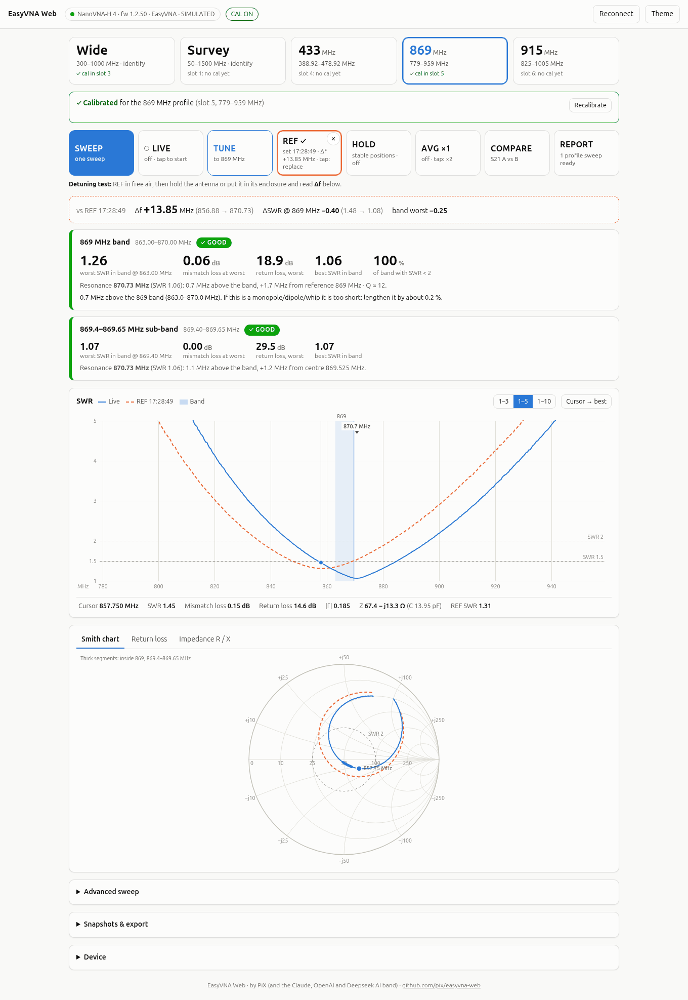
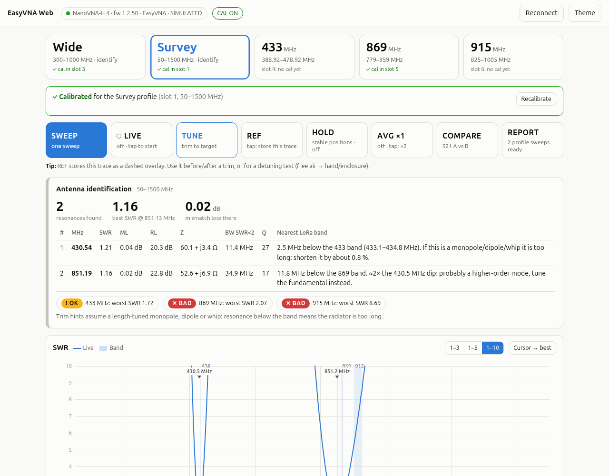
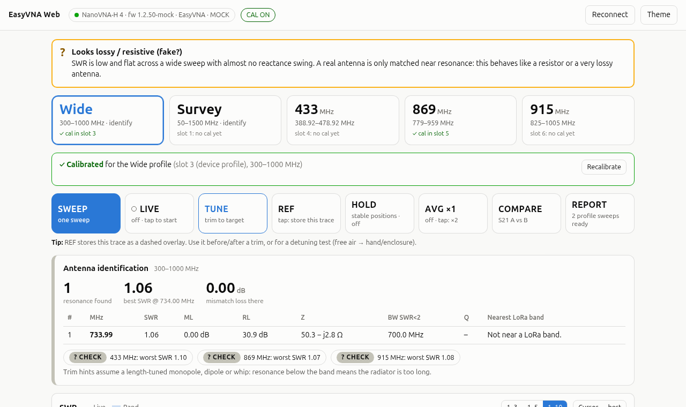
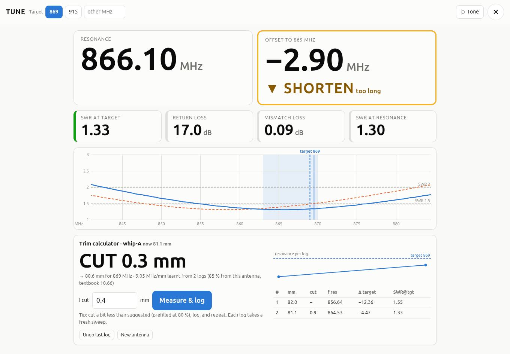
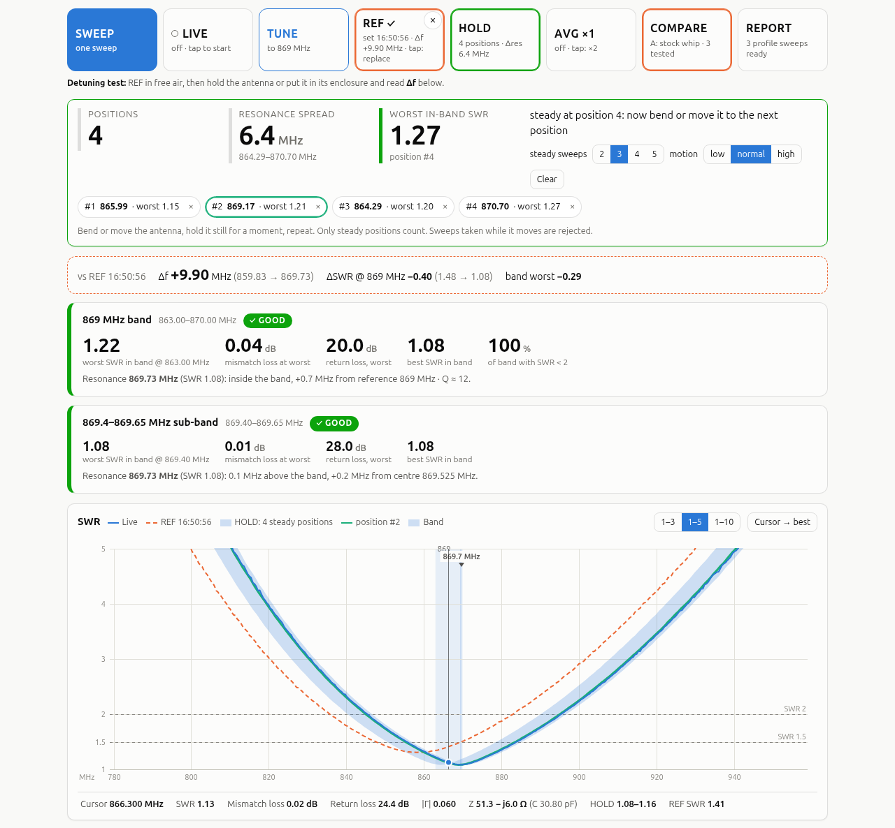
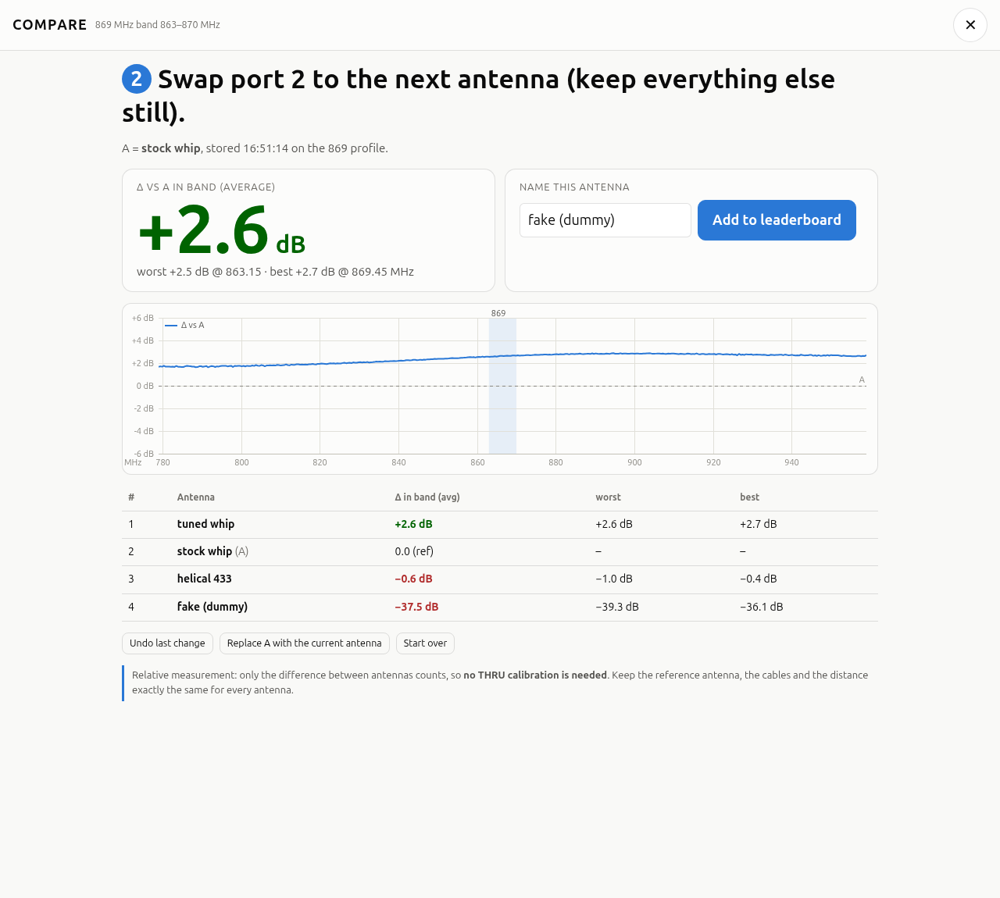
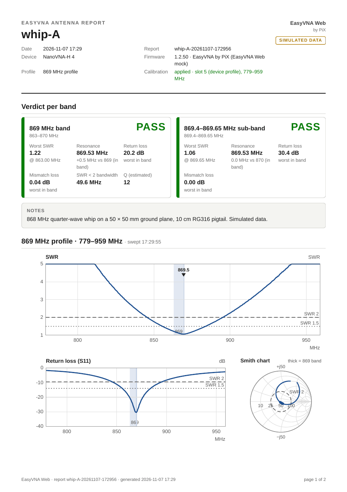
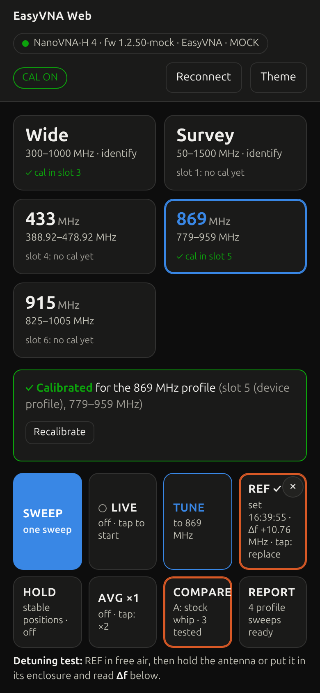
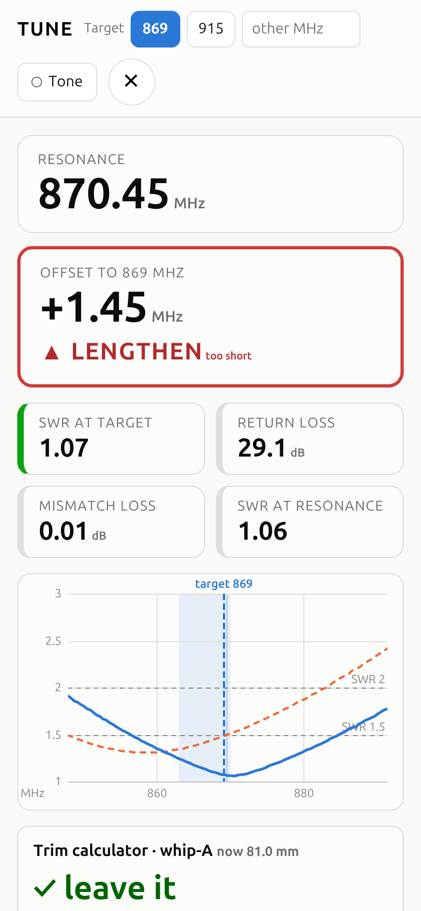

# EasyVNA Web

*by PiX (and the Claude, OpenAI and Deepseek AI band)*

**Plug in a NanoVNA, tap a LoRa band, and see right away whether your antenna is good.** It also helps you trim it, test it and print a report.

> [!WARNING]
> **Developed with Claude (Anthropic's AI assistant, via Claude Code) under
> the direction of PiX.** It is largely AI-generated. It has been tested in
> simulation and on one NanoVNA-H4 under Linux. The Windows build is
> untested on real hardware unless stated. Use at your own risk.



## Why EasyVNA Web

- **One-click LoRa band profiles.** Tap *433*, *869* or *915* for a sweep
  around the band. *Wide* and *Survey* identify an unknown antenna.
- **Verdict at a glance.** Each band gets PASS/OK/FAIL from its worst in-band
  SWR. You also see the resonance and its offset, mismatch loss, return loss
  and Q.
- **TUNE with a trim calculator.** A big live readout says SHORTEN or
  LENGTHEN. The calculator learns your antenna's MHz/mm from each cut, and an
  optional tone lets you trim without looking.
- **HOLD stable positions.** Bend the antenna, hold it, repeat. Only steady
  positions count, so you see how robust the match really is.
- **S21 COMPARE.** Rank antennas against a reference antenna, with no THRU
  calibration needed.
- **Report card.** One button produces a clean A4 or Letter PDF with the verdicts,
  plots, trim log and comparison.
- **Works on a phone** at the bench, in light or dark mode.
- **Runs as a single `.exe` on Windows.** Double-click it and the browser
  opens. Nothing to install, no internet needed.

## Quick start

### Windows

1. Download `easyvna-web-<version>-windows-amd64.zip` from
   [Releases](https://github.com/pix/easyvna-web/releases). Pick `arm64` for
   Windows on ARM.
2. Unzip it and **double-click `easyvna-web.exe`**. A console window says
   *"EasyVNA Web running at http://127.0.0.1:8080. Close this window to
   quit"*, and your browser opens on that page.
3. Plug in the NanoVNA-H4 by USB, switch it on, and press **Reconnect** if
   it was not found at start. Windows 10/11 needs no driver: the NanoVNA is a
   COM port with USB ID `0483:5740` and is found automatically.

> [!NOTE]
> The `.exe` is not code-signed, so Windows SmartScreen may say *"Windows
> protected your PC"* the first time. Click **More info → Run anyway**.

Your settings, REF traces, trim logs and reports are kept in
`%LOCALAPPDATA%\easyvna-web`.

### macOS (Apple silicon)

```sh
tar xzf easyvna-web-<version>-darwin-arm64.tar.gz
./easyvna-web-<version>-darwin-arm64/easyvna-web
```

The macOS build is provided but untested. The NanoVNA is picked
automatically when it is the only `/dev/cu.usbmodem*` device; otherwise use
`-port /dev/cu.usbmodemXXXX`.

### Linux and other systems: build from source

With [Go](https://go.dev/dl/) 1.27 or newer:

```sh
go install github.com/pix/easyvna-web@latest
easyvna-web
```

On Linux your user needs access to the serial port: group `uucp` on Arch,
`dialout` on Debian/Ubuntu. Data is kept in `~/.local/share/easyvna-web`.

### No NanoVNA at hand?

Run `easyvna-web -mock`. It simulates a NanoVNA-H4 and a test antenna, so
you can try every feature. All screenshots on this page were taken that
way.

## Workflow

### 1. Pick a band

Tap **433**, **869** or **915**. Each tap runs one sweep around that band
(**LIVE** keeps sweeping). The band is shaded on the plot. To find out what
an unknown antenna is, use **Wide** (300–1000 MHz) or **Survey**
(50–1500 MHz): every resonance is listed, with its nearest LoRa band and a
trim hint.



### 2. Calibrate if the strip asks for it

The calibration strip is a green one-liner when the active calibration
matches the profile. Otherwise it opens a one-tap
**OPEN → SHORT → LOAD → DONE → SAVE** flow. Fit the standards at the end of
the cable, where the antenna goes. Each profile has its own calibration slot,
so this is a one-time job per band.

### 3. Read the verdict

Each band gets **PASS** (worst in-band SWR < 1.5), **OK** (< 2) or **FAIL**.
Next to the grade you see the resonance and how far it is from the band,
mismatch loss, return loss and the SWR < 2 bandwidth. **REF** stores a trace
as a dashed overlay with Δf / ΔSWR against it, which also makes a quick
detuning test: free air, then in your hand or the enclosure. Automatic
warnings catch *no antenna*, *bad calibration* and *lossy "fake"* antennas.



### 4. TUNE and trim

**TUNE** opens a full-screen live view. It shows the resonance in large
numbers, the offset to the target with **▼ SHORTEN / ▲ LENGTHEN /
✓ ON TARGET**, and SWR at the target. Enter the element length once. After
each cut, enter how much you cut and tap **Measure & log**. The trim
calculator learns this antenna's MHz/mm and tells you the next cut. Turn on
**Tone** to trim by ear.



### 5. Check robustness with HOLD

Turn on **HOLD**, then bend or move the antenna and hold it still in each
position. Sweeps taken while it moves are rejected. Each steady position is
captured, and you get the **resonance spread** and the worst in-band SWR
across all positions.



### 6. COMPARE antennas (S21)

Connect a fixed reference antenna to port 1 and the antenna under test to
port 2. Store antenna **A**, then swap in the others: you see the live
in-band **Δ dB vs A** and can add each antenna to a leaderboard. No THRU
calibration is needed, because only differences count. If S21 is too weak,
move the two antennas closer together.



### 7. Print the report

**REPORT** makes a printable page; use the browser's *Print → Save as PDF*.
It contains:
* a header with the antenna, device, firmware and calibration state;
* PASS/OK/FAIL per band;
* vector SWR, return-loss and Smith plots;
* resonances, the trim log, HOLD positions and S21 results, each only if
  there is data;
* your notes, and *page X of Y* on every page.

Pick **A4** or **Letter** in the report toolbar. The default follows your
browser's language (Letter for the US, Canada, Mexico…) and your last choice
is remembered; `?paper=letter` in the report URL forces it. A typical
antenna fits on two pages. See the A4 sample:
**[doc/sample-report.pdf](doc/sample-report.pdf)**.

<p align="center"></p>

### On a phone

<p align="center">

&nbsp;&nbsp;

</p>

## Features

| | |
|---|---|
| **Profiles** | Wide 300–1000, Survey 50–1500, 433, 869 (plus the 869.4–869.65 sub-band), 915 MHz, and a custom range |
| **Verdict** | PASS / OK / FAIL per band, with worst/best SWR, return loss, mismatch loss, resonance offset, SWR < 2 bandwidth and Q. Band edges are interpolated |
| **Identify** | every resonance with SWR, R+jX, bandwidth and Q, the nearest LoRa band, and higher-order modes flagged |
| **Calibration** | one-tap OPEN/SHORT/LOAD/DONE/SAVE per profile, with slot tracking, auto-recall, and a warning when the calibration does not fit the sweep |
| **TUNE** | live narrow sweep, SHORTEN/LENGTHEN, SWR at the target, optional audio tone |
| **Trim calculator** | learns MHz/mm from each cut, per-antenna logs with undo |
| **REF** | one-tap reference trace, Δf / ΔSWR, detuning test |
| **HOLD** | stable-positions envelope with motion rejection and resonance spread |
| **AVG** | averaging over ×1 / 2 / 4 / 8 / 16 sweeps |
| **COMPARE** | S21 against antenna A, live Δ dB in band, leaderboard |
| **Warnings** | no antenna or open cable, reflection above 1 (bad calibration), lossy / fake antenna |
| **Report** | printable A4 / Letter report with vector plots and tables, saved in the data folder |
| **Export** | Touchstone `.s1p` / `.s2p`, CSV, named snapshots |
| **Plots** | SWR, return loss, Smith chart, R/X, S21, with a cursor readout |
| **Anywhere** | phone layout, light and dark mode, works offline |

## Options

| flag | default | meaning |
|---|---|---|
| `-listen` | `127.0.0.1:8080` | HTTP address. If 8080 is taken and `-listen` was not given, the next free port is used |
| `-no-browser` | off | do not open the browser at start-up |
| `-port` | auto | serial port, e.g. `COM5`, `/dev/ttyACM0`, `/dev/serial/by-id/usb-nanovna.com_NanoVNA-H4_400-if00`. Auto-detect looks for USB `0483:5740` |
| `-readonly` | off | never change anything stored on the device: calibration, save, recall and on-device profile switching are refused. Sweeps still work |
| `-data` | per OS | folder for settings, REF traces, trim logs, compare session, reports and snapshots |
| `-mock` | off | simulate a NanoVNA-H4 (no hardware needed) |
| `-mock-antenna` | `dual` | simulated antenna: `dual`, `869`, `869tuned`, `915`, `dummy`, `open`, `bend` |
| `-mock-firmware` | `custom` | `custom` simulates the EasyVNA firmware, `stock` plain NanoVNA-D |
| `-maxpoints` | auto | points per device scan (401 on H4, 101 on H) |
| `-cal-settle` | `1.5s` | time with a standard attached before `cal <std>` (older firmware) |
| `-trace` | off | log every exchange with the device |
| `-version` | | print the version and exit |

## Firmware

EasyVNA Web works with **stock NanoVNA-H / H4 firmware** (NanoVNA-D by
DiSlord and compatible). It works best with the **EasyVNA firmware**
(<https://github.com/pix/easyvna>), which adds the same LoRa profiles on
the device itself, so the device and the browser stay in sync. EasyVNA Web
recognises it automatically, and the device badge then shows **EasyVNA**.

Both firmwares use the same calibration slots, so a calibration saved from
either side is found by the other:

| profile | range (MHz) | points | slot |
|---|---|---|---|
| survey | 50–1500 | 401 | 1 |
| wide | 300–1000 | 401 | 3 |
| 433 | 388.92–478.92 | 401 | 4 |
| 869 | 779–959 | 401 | 5 |
| 915 | 825–1005 | 401 | 6 |
| custom | as saved | as saved | 2 |

Slot 0 is left to you; stock firmware loads it at power-on. Offsets are
measured from 433.92, 869 and 915 MHz. With the EasyVNA firmware, tapping a
profile also makes the device remember it as the last-used profile, which
is a small flash write. `-readonly` avoids that.

## FAQ and troubleshooting

**"COM5 is busy" / "in use by …"**
Another program has the port open: NanoVNA-Saver, a serial terminal, or a
second copy of EasyVNA Web. Close it, then press **Reconnect**.

**"No NanoVNA found"**
Check that the NanoVNA is switched on and connected with a *data* USB cable
(some cables only charge). On Windows, look under *Device Manager → Ports*
for a "USB Serial Device (COMx)"; if it shows another ID, start with
`-port COMx`. On Linux, check the serial-port permissions (`uucp` or
`dialout` group).

**Windows says "Windows protected your PC"**
The program is not code-signed. Click *More info → Run anyway*.

**The calibration strip stays orange**
The active calibration was made for a different frequency range. Calibrate
this profile once with **OPEN → SHORT → LOAD → DONE → SAVE**; after that it
is recalled automatically.

**"Reflection above 1" warning**
The calibration does not match the current setup: a different cable or
adapter, or a stale calibration. Recalibrate at the end of the cable you
measure with.

**S21 COMPARE reading is very low or noisy**
Move the reference antenna and the antenna under test closer together (a
few tens of cm), keep the cables still, and use the same placement for
every antenna.

**The browser did not open**
Open the address shown in the console window (normally
http://127.0.0.1:8080) yourself, or use `-no-browser` and bookmark it.

**Where is my data?**
In `%LOCALAPPDATA%\easyvna-web` on Windows, `~/.local/share/easyvna-web` on
Linux, and `~/Library/Application Support/easyvna-web` on macOS. Use `-data`
to choose another folder.

## Development

```sh
go build -o easyvna-web .
go test -race ./... && go vet ./...
./easyvna-web -mock
```

Build commands, release and screenshot scripts, the HTTP API, code layout,
NanoVNA shell protocol notes and how to add a NanoVNA V2 driver are in
**[doc/DEVELOPMENT.md](doc/DEVELOPMENT.md)**.

## Credits

EasyVNA Web is by PiX (and the Claude, OpenAI and Deepseek AI band).

## License

BSD-3-Clause, see [LICENSE](LICENSE). Copyright (c) 2026, Camille Moncelier
(PiX).

EasyVNA Web is a separate program that talks to the NanoVNA over USB and
contains no firmware code. The EasyVNA firmware itself is based on
NanoVNA-D and keeps that project's GPL-3.0 license.
