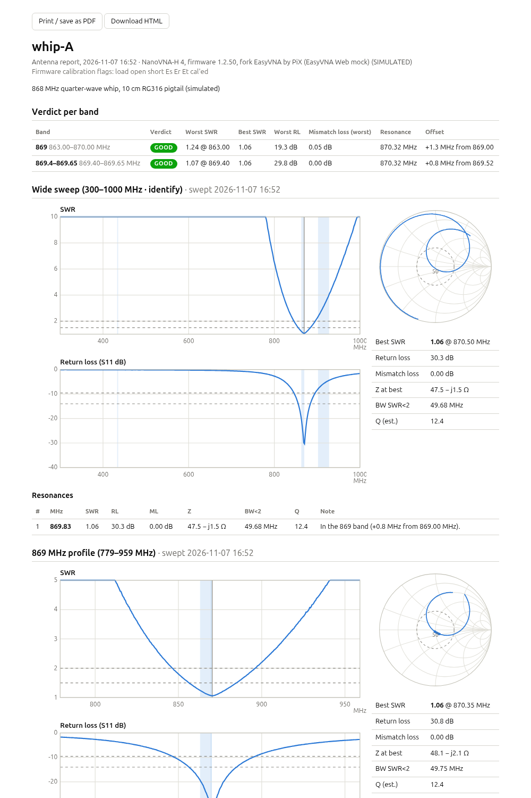

# EasyVNA Web

*by PiX (and the Claude, OpenAI and Deepseek AI band)*

**Check LoRa antennas with a NanoVNA, in your browser.** EasyVNA Web is a
single program (one `.exe` on Windows) that drives a NanoVNA-H / H4 over USB
and gives you a clear verdict per LoRa band (433 / 869 / 915 MHz). It also
has a trimming assistant, a stable-positions HOLD, S21 antenna comparison and
a printable report card. It works offline and on a phone at the bench.

> [!WARNING]
> **Developed with Claude (Anthropic's AI assistant, via Claude Code) under
> the direction of PiX.** It is largely AI-generated. It has been tested in
> simulation and on one NanoVNA-H4 under Linux. The Windows build is
> untested on real hardware unless stated. Use at your own risk.


## Why EasyVNA Web

- **One-click LoRa band profiles.** Tap *433*, *869* or *915* and get a
  sweep centred on the band. *Wide* (300–1000 MHz) and *Survey*
  (50–1500 MHz) identify an unknown antenna.
- **Verdict at a glance.** Each band is graded GOOD, OK or BAD from its worst
  in-band SWR. You also see the resonance and its offset, mismatch loss,
  return loss and Q.
- **TUNE with a trim calculator.** A full-screen live view shows the
  resonance and a big SHORTEN or LENGTHEN arrow. The calculator learns your
  antenna's MHz/mm from each cut. An optional tone lets you trim without
  looking.
- **HOLD stable positions.** Bend the antenna, hold it, bend again. Only
  steady positions count, and you get the resonance spread: how robust is
  the match?
- **S21 COMPARE.** Rank antennas against a reference antenna, with no THRU
  calibration needed.
- **Report card.** One button produces a printable page (print to PDF) with
  verdicts, plots, the trim log and compare results.
- **Works on a phone.** The layout adapts to a phone, so you can keep it in
  your hand at the bench.
- **Runs as a single .exe on Windows.** Double-click it and the browser
  opens. There is nothing to install and no internet is needed. A macOS
  build is provided too, and on Linux it builds from source in one command.

## Screenshots

The screenshots below were taken with the built-in simulator (`-mock`).

| | |
|---|---|
|  |  |
| *Survey: every resonance, its nearest LoRa band and a trim hint* | *TUNE: live resonance, SHORTEN/LENGTHEN, learnt MHz/mm* |
|  |  |
| *HOLD: only steady positions, plus the resonance spread* | *S21 COMPARE: Δ dB vs antenna A and a leaderboard* |
|  |  |
| *Report card (print → PDF)* | *Automatic warnings: no antenna, bad calibration, lossy "fake" antenna* |
|  |  |
| *On a phone* | *TUNE on a phone* |

## Quick start

### Windows

1. Download `easyvna-web-<version>-windows-amd64.zip` from
   [Releases](https://github.com/pix/easyvna-web/releases). Pick `arm64` for
   Windows on ARM.
2. Unzip it anywhere and **double-click `easyvna-web.exe`**. A console window
   says *"EasyVNA Web running at http://127.0.0.1:8080. Close this window
   to quit"*, and your browser opens on that page.
3. Plug in the NanoVNA-H4 by USB and switch it on, then press **Reconnect**
   if it was not found at start. Windows 10/11 needs no driver; the NanoVNA
   shows up as a COM port (USB ID `0483:5740`) and is found automatically.

The program is not code-signed, so SmartScreen may warn about it the first
time (*More info → Run anyway*). Settings, REF traces, trim logs and reports
are stored in `%LOCALAPPDATA%\easyvna-web`. If another program such as
NanoVNA-Saver has the COM port open, EasyVNA Web says the port is busy.
Close the other program and press Reconnect.

### Linux (build from source)

There are no Linux release downloads. With Go 1.27 or newer, building takes
one command:

```sh
go install github.com/pix/easyvna-web@latest   # or: git clone … && go build .
easyvna-web
```

Your user needs access to the serial device: group `uucp` on Arch, `dialout`
on Debian/Ubuntu. Data lives in `~/.local/share/easyvna-web`.

### macOS

```sh
tar xzf easyvna-web-<version>-darwin-arm64.tar.gz
./easyvna-web-<version>-darwin-arm64/easyvna-web
```

macOS builds are provided but untested. The NanoVNA is picked automatically
when it is the only `/dev/cu.usbmodem*` device; otherwise use
`-port /dev/cu.usbmodemXXXX`.

### Try it without hardware

```sh
easyvna-web -mock
```

`-mock` simulates a NanoVNA-H4 with a test antenna. Under *Device* in the UI
you can swap the simulated antenna: tuned, detuned, helical, a fake dummy
load, an open cable, or a whip being bent.

## Options

| flag | default | meaning |
|---|---|---|
| `-listen` | `127.0.0.1:8080` | HTTP address. If 8080 is taken and `-listen` was not given, the next free port is used |
| `-no-browser` | off | do not open the browser at start-up |
| `-port` | auto | serial device, e.g. `COM5`, `/dev/ttyACM0`, `/dev/serial/by-id/usb-nanovna.com_NanoVNA-H4_400-if00`. Auto-detect looks for USB `0483:5740` |
| `-readonly` | off | never change stored device state: calibration, save, recall and on-device profile switching are refused. Sweeps still work. Use this when someone else's calibration must not be touched |
| `-data` | per OS (see above) | settings, REF traces, trim logs, compare session, reports, snapshots |
| `-mock` | off | simulate a NanoVNA-H4 (no hardware needed) |
| `-mock-antenna` | `dual` | `dual`, `869`, `869tuned`, `915`, `dummy`, `open`, `bend` |
| `-mock-firmware` | `custom` | `custom` simulates the EasyVNA firmware (`profile` command), `stock` plain NanoVNA-D |
| `-maxpoints` | auto | points per device scan (401 on H4, 101 on H) |
| `-cal-settle` | `1.5s` | time with a standard attached before `cal <std>` (older firmware) |
| `-trace` | off | log every shell exchange |
| `-version` | | print the version and exit |

## Firmware

EasyVNA Web works with **stock NanoVNA-H / H4 firmware** (NanoVNA-D by
DiSlord and compatible), and best with the **EasyVNA firmware**
(https://github.com/pix/easyvna). The EasyVNA firmware adds the same LoRa
profiles on the device and a `profile` shell command, which keeps the device
and the browser in sync. EasyVNA Web recognises it from the
`Fork: EasyVNA by PiX (...)` line (older builds print `Fork: PiX (...)`), or
from `help` listing `profile`. The device badge then shows **EasyVNA**.

Profiles and calibration slots are the same with both firmwares, so a
calibration saved from either side is found by the other:

| profile | range (MHz) | points | slot |
|---|---|---|---|
| survey | 50–1500 | 401 | 1 |
| wide | 300–1000 | 401 | 3 |
| 433 | 388.92–478.92 | 401 | 4 |
| 869 | 779–959 | 401 | 5 |
| 915 | 825–1005 | 401 | 6 |
| custom | as saved | as saved | 2 |

Slot 0 is left to you; stock firmware loads it at power-on. Offsets are
measured from 433.92, 869 and 915 MHz. With the EasyVNA firmware, tapping a
profile also makes the device remember it as the last-used profile, which
is a small flash write. `-readonly` avoids that.

## Using it

The page reads top to bottom. Pick a profile, calibrate if the strip asks
for it, then use the big action tiles. Every tile shows its state. Anything
that overwrites data says so first, and cheap actions offer **Undo**.

1. **Profiles.** One tap sweeps once.
2. **Calibration strip.** It is a green one-liner when the active
   calibration matches the profile. Otherwise it opens a one-tap
   **OPEN → SHORT → LOAD → DONE → SAVE** flow. Fit the standards at the end
   of the pigtail, where the antenna goes. Each profile needs its own
   calibration.
3. **Tiles:**
   * **SWEEP**: one sweep.
   * **LIVE**: continuous sweeping.
   * **TUNE**: full-screen trimming (below).
   * **REF**: one tap stores the trace as a dashed overlay, and the page
     then shows Δf and ΔSWR against it. For a detuning test, take a REF in
     free air, then hold the antenna or put it in its enclosure and read Δf.
   * **HOLD**: stable positions (below).
   * **AVG**: average ×1, 2, 4, 8 or 16 sweeps.
   * **COMPARE**: S21 comparison (below).
   * **REPORT**: the report card (below).
4. **Automatic warnings.** *No antenna?* means |Γ| ≈ 1 everywhere.
   *Reflection above 1* means the calibration does not fit. *Looks lossy /
   resistive (fake?)* means SWR is low and flat across a wide sweep. While
   a warning is shown, the verdicts read **CHECK** instead of GOOD.
5. **Verdict.** GOOD means the worst in-band SWR is below 1.5, OK below 2,
   BAD otherwise. Band edges are interpolated, so a coarse sweep cannot hide
   a bad edge. Trim hints assume a length-tuned monopole, dipole or whip:
   resonance below the band means the radiator is too long.
6. **Plots.** The SWR plot shows the band, REF and HOLD. The Smith chart,
   return loss, R/X and S21 are in tabs.

**TUNE and the trim calculator.** TUNE runs a fast, narrow sweep that
follows the resonance. It shows the offset to the target, SWR, RL and
mismatch loss at the target, and an optional tone whose pitch rises as SWR
falls.
* Enter the element length once. The first prediction is
  `L × f_res / f_target`.
* After each cut, enter how much you cut (prefilled at 80 % of the
  suggestion) and tap *Measure & log*.
* The calculator learns your antenna's MHz/mm. It starts from the textbook
  value, and your logged cuts take over once they move the resonance clearly
  beyond the measurement noise.
* Logs are stored per antenna.

**HOLD: stable positions.** Use it for bend and hand-effect tests.
* A sweep that differs from the previous one by more than the motion
  threshold is shown as *moving…* and rejected.
* When N sweeps in a row agree (default 3), they are averaged and captured
  as one position.
* The envelope covers captured positions only. The panel shows the
  **resonance spread** and the worst in-band SWR across all positions.
* Motion sensitivity is low, normal or high: 0.010, 0.006 or 0.004 RMS
  |ΔΓ|. A static antenna on an H4 measures about 0.0016.

**S21 COMPARE.** Port 1 goes to a fixed reference antenna and port 2 to the
antenna under test. Store antenna A, then swap in the others: you see the
in-band Δ dB against A live, and can add each antenna to a leaderboard. The
numbers are relative only, so no THRU calibration is needed. Keep the
geometry fixed between antennas.

**REPORT.** Pick a name and the sweeps to include. You get a printable HTML
page (Print → Save as PDF) with:
* the verdict per band;
* SWR, RL and Smith plots;
* resonances with bandwidth and Q;
* the trim log and compare results.

Reports are saved in the data directory.

## Developer notes

```sh
go build -o easyvna-web .          # build (Go 1.27+)
go test -race ./... && go vet ./...
./easyvna-web -mock                # simulated NanoVNA-H4, no hardware
scripts/dist.sh v0.1.0             # release archives + SHA256SUMS into dist/
scripts/screenshots.sh mock        # regenerate doc/screenshots (needs node + playwright)
scripts/screenshots.sh hardware    # same against a real NanoVNA, server in -readonly
```

Everything builds with `CGO_ENABLED=0` for Windows (amd64/arm64), Linux and
macOS. Releases ship Windows zips (amd64, arm64) and a macOS arm64 tarball.
Linux users build from source. The only dependency is `golang.org/x/sys`. Serial ports use raw
termios on Linux and macOS, and the Win32 comm API on Windows. Port
detection uses sysfs on Linux, the registry on Windows (USB VID:PID, cross-
checked with `HARDWARE\DEVICEMAP\SERIALCOMM` to skip unplugged devices),
and `/dev/cu.usbmodem*` on macOS. CI runs vet and tests on Linux, plus tests
and a mock smoke test on Windows. Pushing a `v*` tag builds the release
archives.

### HTTP API

| | |
|---|---|
| `GET /api/state` | device, config, calibration, profiles |
| `GET /api/events` | SSE: `state`, `sweep`, `snapshots` |
| `POST /api/connect` | (re)connect |
| `POST /api/profile` `{"id":"869"}` | apply a profile (wide, 433, 869, 915, or custom = range saved in slot 2) |
| `POST /api/config` `{"start","stop","points","s21","portExtPs"}` | custom sweep |
| `POST /api/sweep` | single sweep, returns the result |
| `POST /api/continuous` `{"on":true}` | continuous sweeping (results via SSE) |
| `GET /api/last` | last result |
| `GET /api/export?format=s1p\|s2p\|csv[&snapshot=name]` | download |
| `POST /api/avg {"n":4}` | averaging (1, 2, 4, 8, 16) |
| `POST /api/tune {"on":true,"target":869000000}` / `{"on":false}` | TUNE mode |
| `POST /api/ref`, `DELETE /api/ref`, `POST /api/ref/undo`, `GET /api/ref?profile=` | REF trace per profile |
| `GET /api/trim`, `GET /api/trim/{name}`, `POST /api/trim/{name}/log {"lengthMm"} or {"cutMm"}`, `.../undo`, `.../target`, `.../select` | trim sessions |
| `POST /api/compare {"on"}`, `POST /api/compare/a {"name"}`, `POST /api/compare/add {"name"}`, `POST /api/compare/undo`, `DELETE /api/compare` | S21 compare |
| `POST /api/report {"name","profiles","trim","notes"}`, `GET /api/reports`, `GET /api/reports/{file}[?download=1]` | reports |
| `POST /api/hold {"on"}` / `{"n"}` / `{"sensitivity"}` / `{"clear":true}` / `{"remove":id}` / `{"undo":true}`, `GET /api/hold` | HOLD stable positions |
| `POST /api/mock/antenna {"name"}` | mock only: swap the simulated antenna |
| `GET/POST /api/snapshots`, `GET/DELETE /api/snapshots/{name}` | snapshots |
| `GET /api/cal`, `POST /api/cal/step/{reset,open,short,load,isoln,thru,done,on,off}`, `POST /api/cal/save {"slot"}`, `POST /api/cal/recall {"slot"}` | calibration |
| `PUT /api/profiles/{id}/slot {"slot"}`, `POST /api/settings {"autoRecall"}` | settings |

Example: `curl -s -XPOST localhost:8080/api/sweep | jq .summary.bands`

### Code layout

```
main.go, platform.go         flags, data dir per OS, port choice, browser, wiring
web/                         embedded UI (index.html, app.js, style.css; vanilla JS + canvas)
internal/rf/                 RF math: SWR, RL, mismatch loss, Z, Q, port extension,
                             bandwidth, dips, band verdicts, warnings, REF deltas,
                             TUNE readout, trim learning, Touchstone/CSV
internal/vna/                Device interface (+ optional Profiler)
internal/vna/nanovnah/       NanoVNA-H/H4 shell driver: shell I/O, parser, driver
internal/vna/mock/           byte-level shell simulator + multi-mode antenna model
internal/serialport/         serial ports: termios (Linux/macOS), Win32 comm API (Windows);
                             detection via sysfs / registry / cu.usbmodem; busy-port check
internal/server/             HTTP API, SSE hub, sweep loop, profiles, averaging, TUNE,
                             REF, trim, compare, report (SVG), store
```

### Shell protocol notes (NanoVNA-D `main.c`)

* Commands end with `\r` (`\n` is ignored), the line limit is 64 characters
  and the shell takes at most 4 arguments. Every character is echoed, Enter
  prints `\r\n`, output lines end in `\r\n`, and the prompt is `ch> `.
* An unknown command prints `<name>?`. Bad arguments print `usage: ...`.
  Asking for too many points prints `sweep points exceeds range N`.
* `scan start stop points outmask` takes mask bits 1 = freq, 2 = S11,
  4 = S21, 8 = no cal, 16 = no e-delay, 32 = no S21 offset, 128 = binary.
  Text output is one `freq re im [re im] ` line per point. `scan` pauses the
  on-device sweep; EasyVNA Web sends `resume` when it disconnects.
* `cal` with no arguments prints the set status bits by name:
  `load open short thru isoln Es Er Et cal'ed`, where `cal'ed` means the
  correction is applied.
* If `scan` prints nothing (firmware without outmask), the driver falls back
  to `sweep` + `resume` + `pause` + `frequencies` + `data 0/1`.

### Adding the NanoVNA V2 driver

The V2 (`04b4:0008`) uses a binary register protocol, not a text shell.
EasyVNA Web already detects it and reports that it is not supported. To add it:

1. Create `internal/vna/nanovnav2/` with a type that implements `vna.Device`
   (`internal/vna/vna.go`): `Info`, `Scan`, `CalStatus`, `Calibrate`, `SaveCal`,
   `RecallCal`, `Close`. Reuse `serialport.Open` for the transport.
2. `Scan` has to return frequencies plus S11 (and S21 when `req.S21` is set),
   with any segmentation hidden inside the driver. Everything else (analysis,
   UI, export) works unchanged.
3. The V2 has no on-device SOL calibration over USB. Return a `CalStatus`
   with `Known: false`, and either return an error from `Calibrate` or
   implement host-side SOL error correction inside the driver.
4. In `platform.go`, change `pickPort()` to return the V2 device, and in
   `main.go` open it with the new driver.
5. Test it the same way as the H driver: a scripted transport for the parser
   and a simulator for the driver.

### Tests

They cover the RF math (analytic series-RLC checks, bandwidth interpolation,
band-edge interpolation, dip and harmonic classification, Touchstone
round-trips) and the shell parser (recorded and synthetic transcripts: echo,
stale prompts, unknown or usage errors, trailing spaces, nan). They also run
the driver against a scripted transport and the byte-level simulator
(segmentation, learning the point limit, legacy fallback, cal flow, device
profiles), sysfs detection with a fake tree, Windows registry detection
with a fake registry (phantom ports, composite devices, COM10+), the
per-OS data dir, port choice and port fallback, and the HTTP API end to end
(profiles, cal, REF, TUNE/trim, HOLD, compare, report, snapshots, export,
SSE). Simulations of a trim session and of a hand-bent antenna check that
the trim fit and the HOLD motion rejection work.

## Credits

EasyVNA Web is by PiX (and the Claude, OpenAI and Deepseek AI band).

## License

BSD-3-Clause, see [LICENSE](LICENSE). Copyright (c) 2026, Camille Moncelier
(PiX).

EasyVNA Web is a separate program that talks to the NanoVNA over USB and
contains no firmware code. The EasyVNA firmware itself is based on
NanoVNA-D and keeps that project's GPL-3.0 license.
